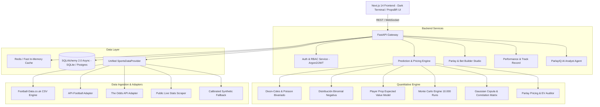

# PARLAYIQ — Arquitectura del Sistema

## 1. Visión General
**PARLAYIQ** es una plataforma de inteligencia deportiva cuantitativa orientada a la predicción estadística de partidos de fútbol y optimización de combinadas (Parlays y Same Game Parlays - SGP). 

Diferenciadores nucleares:
1. **Player Intelligence**: Desglose granular de rendimiento de futbolistas (tiros, tiros al arco, faltas, tarjetas, xG), no sólo promedios simples, sino minutos esperados, rendimiento vs estilo del rival, titularidad y tasas de acierto L5/L10.
2. **Value Finder**: Identificación estricta de Valor Esperado positivo ($EV = P \times \text{Cuota} - 1$), diferenciando probabilidad bruta de valor matemático real.
3. **Live Match Intelligence**: Ajuste bayesiano de probabilidades dinámicas según eventos en vivo (ritmo, tiros, tarjetas, xG en directo).
4. **Prediction Track Record**: Auditoría histórica inmutable con Brier Score, Expected Calibration Error (ECE) y ROI simulado.
5. **AI Match Scanner**: Agente analista cuantitativo que rastrea y filtra oportunidades del día.
6. **Smart Parlay Optimizer & Bet Builder**: Simulación de Monte Carlo (10.000 iteraciones) asistida por matrices de correlación y cópula gaussiana para no multiplicar erróneamente eventos dependientes.

---

## 2. Diagrama de Arquitectura

---

## 3. Modelo de Capas

- **Capa de Dominio & Datos (`backend/app/models`)**: Modelos desacoplados de persistencia para Equipos, Jugadores, Competiciones, Partidos, Estadísticas, Cuotas, Predicciones, Slips y Rendimiento.
- **Capa Cuantitativa (`backend/app/engine`)**: Módulos puros en NumPy / SciPy sin dependencias de base de datos ni interfaz web, facilitando pruebas unitarias de precisión matemática.
- **Capa de Adaptadores (`backend/app/providers`)**: Implementación del patrón Strategy/Adapter. Todo proveedor expone el contrato `SportsDataProvider`.
- **Capa de Agentes (`backend/app/agents`)**: Analista cuantitativo con razonamiento estructurado para explicar riesgos, ventajas estadísticas y evitar sobreconfianza.
